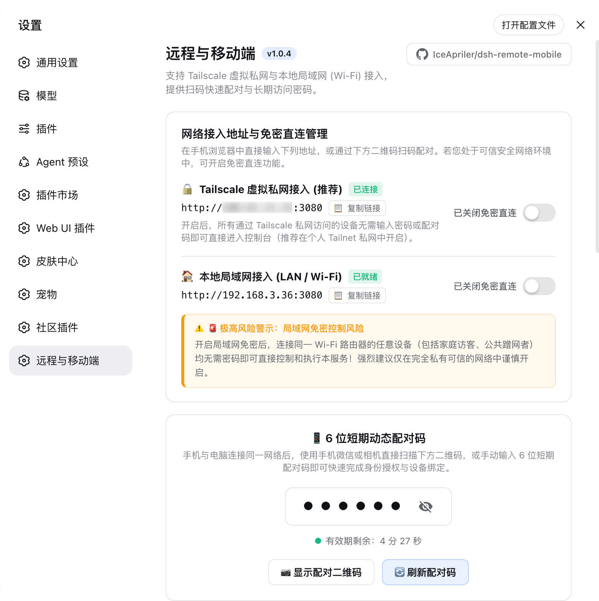
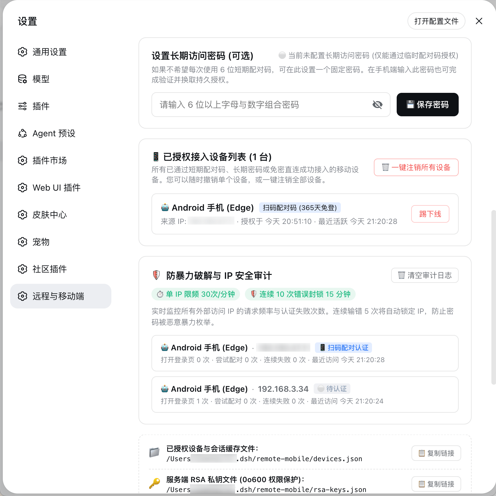
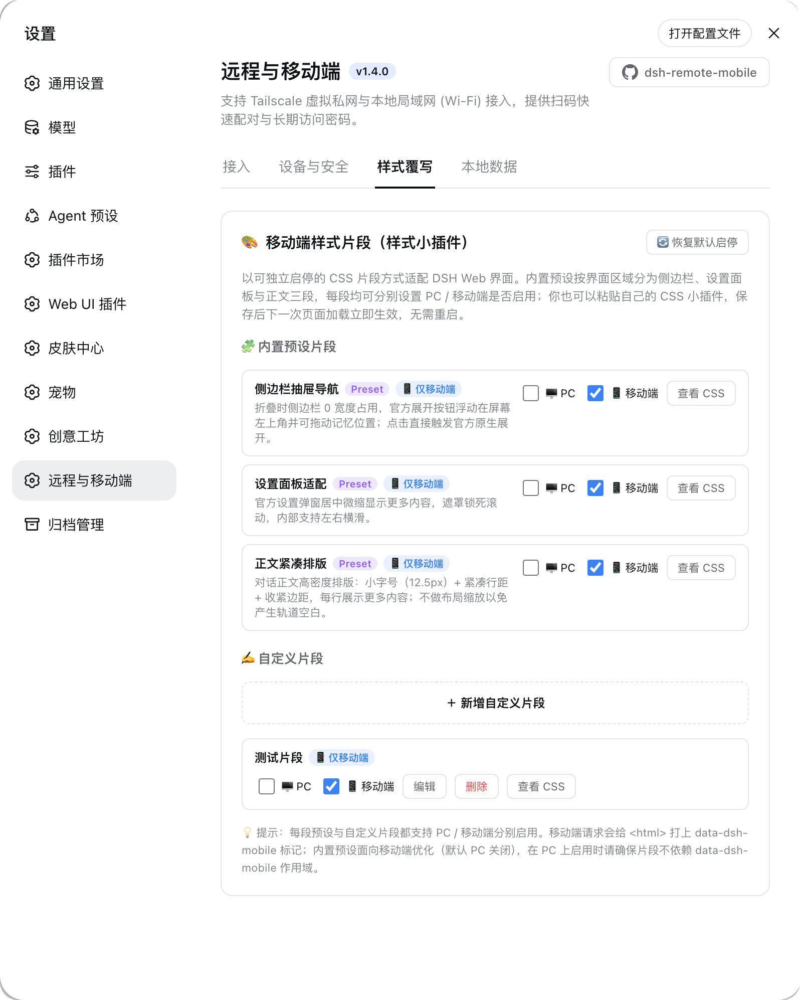
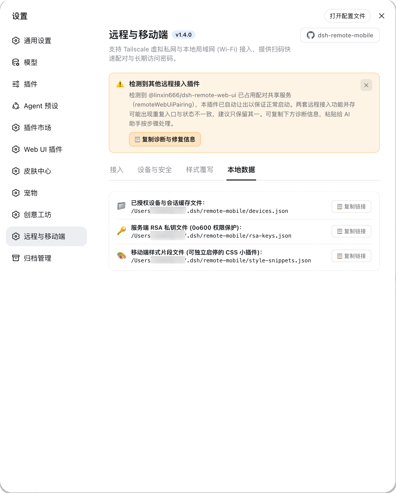
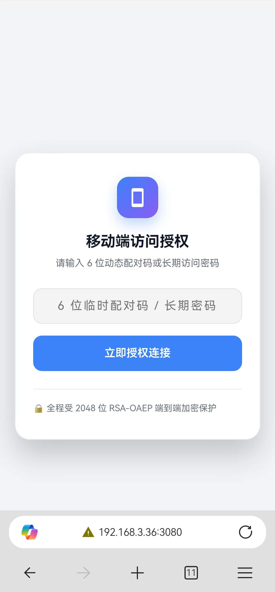
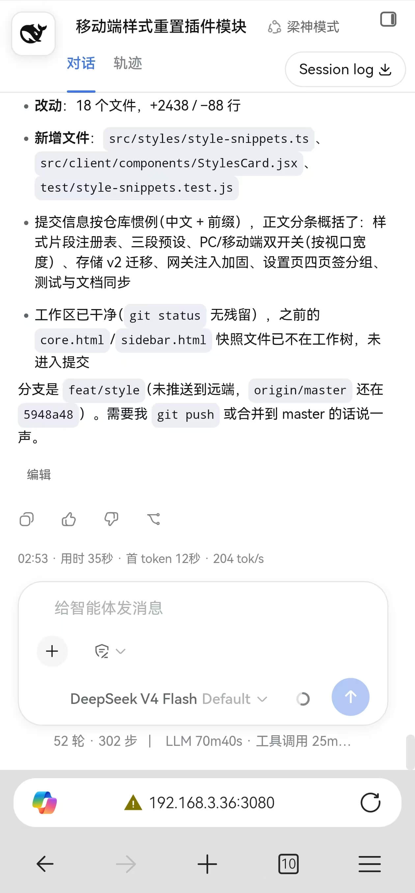
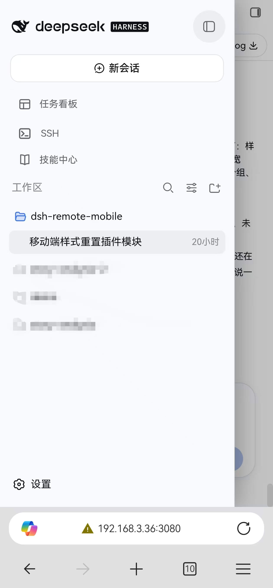
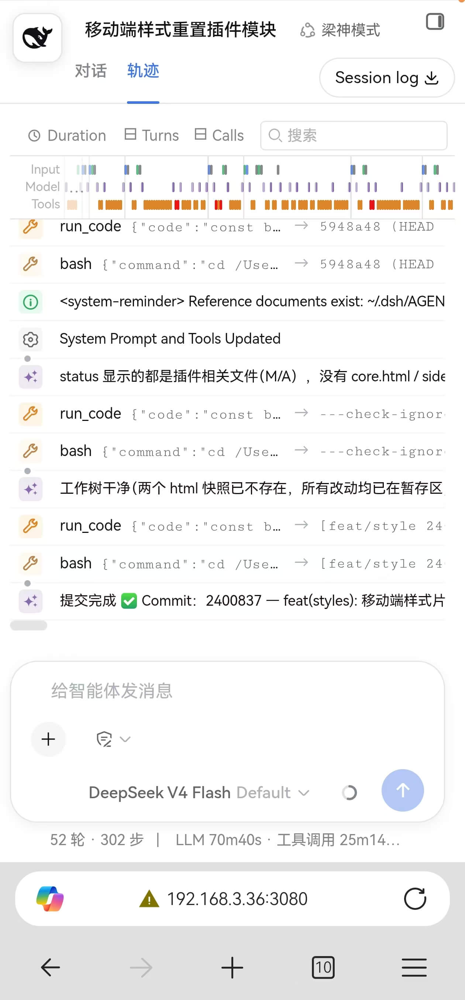

<div align="center">

# dsh-remote-mobile

**DeepSeek Harness (DSH) Remote & Mobile Secure Access Proxy Plugin**

[](https://www.npmjs.com/package/dsh-remote-mobile)
[](https://www.npmjs.com/package/dsh-remote-mobile)
[](https://nodejs.org)
[](https://github.com/IceApriler/dsh-remote-mobile/blob/master/LICENSE)
[](https://github.com/IceApriler/dsh-remote-mobile)
[](https://github.com/IceApriler/dsh-remote-mobile/pulls)

<p align="center">
  <b>Zero Core Modifications · Secure LAN / Tailscale Access · QR Pairing · Mobile UI Adaptation · Workspace Parity · Real-Time Push</b>
</p>

<p align="center">
  📱 <b>Desktop-grade mobile workspace</b>: create / switch workspaces and run terminal commands on your phone<br>
  🛡️ <b>Multi-tier auth</b>: QR pairing · persistent password · passwordless bypass + RSA encryption + brute-force lockout<br>
  🎨 <b>Mobile style snippets</b>: three built-in presets, fully customizable with your own CSS
</p>

English Documentation · [简体中文](./README.md)

<p align="center">
  <a href="#about">About</a> •
  <a href="#advantages">Key Advantages</a> •
  <a href="#quick-start">Quick Start</a> •
  <a href="#config">Configuration</a> •
  <a href="#preview">UI Preview</a> •
  <a href="#features">Features</a> •
  <a href="#install">Installation & Update</a> •
  <a href="#advanced">Advanced Configuration</a> •
  <a href="#storage">Local File Storage</a> •
  <a href="#faq">FAQ</a>
</p>

---

</div>

<span id="about"></span>
## 📖 About

`dsh-remote-mobile` is a dedicated remote and mobile security governance plugin designed specifically for **DeepSeek Harness (DSH)**.

By default, DSH strictly listens only to the local loopback address (`127.0.0.1`), preventing mobile devices, tablets, or external computers from accessing the Web console. This plugin uses **access control middleware** and **request isolation** to securely open up **Tailscale Private Network** and **Local Area Network (LAN / Wi-Fi)** access, complete with RSA transmission encryption, QR code pairing, persistent password auth, and automated brute-force defense.

When accessed from a phone, the plugin also adapts the DSH interface for **mobile styles**: a collapsible sidebar drawer with a draggable floating toggle, compatibility with the official 3-column Grid layout & right sidebar, a centered/scaled settings dialog, and dense conversation typography — so the mobile experience feels closer to the desktop.

---

<span id="advantages"></span>
## ⚡ Key Advantages

* 🚀 **Break Network Barriers with Desktop-Grade Workspace**: For accessing DSH Web over LAN / Tailscale. On mobile devices, **common desktop operations such as creating / switching workspaces and running terminal commands are supported**.
* 📱 **Dedicated Mobile Adaptations & Same-Origin Reuse**: Directly reuses the official DSH Web frontend (the very same UI as desktop) and the wider plugin ecosystem (sidebars, task boards, terminal panels, etc.) without maintaining a separate mobile backend. Includes out-of-the-box mobile adaptations (sidebar drawer toggle, centered settings modal, and compact chat font scaling for higher information density), alongside a built-in **Style Snippet Override system** to toggle presets or inject custom CSS snippets on demand.
* 🛡️ **Secure Access Proxy & Transport Encryption**: Built-in client-side RSA asymmetric public key encryption, `scrypt` salted slow-hashing password persistence, and automated IP lockout upon consecutive brute-force failures, blocking unauthorized access over public/LAN networks.
* 📲 **Quick QR Pairing**: Auto-detects Tailscale CGNAT and LAN IP addresses to generate dedicated pairing QR codes. Scan the code to authenticate and obtain persistent credentials.
* 🔄 **SSE Real-Time Push**: Device connection, reconnection, revocation, and security alert events are pushed in real time via Server-Sent Events without polling.
* 🤝 **Generic Plugin Coexistence Protection**: Starts safely alongside other remote/Web access plugins by automatically yielding the shared service; the settings panel shows a conflict banner with a one-click copyable diagnosis & fix report.

---

<span id="quick-start"></span>
## 🚀 Quick Start

### 1. One-Command Installation

Run the DSH official plugin management command in your terminal (Recommended):

```bash
dsh plugin --profile web add dsh-remote-mobile
```

> [!IMPORTANT]
> **Ecosystem Plugin Advice**: **Installing `@linxin666/dsh-web-all` (all-in-one package) is not recommended**. We suggest **installing individual standalone plugins on demand**. The all-in-one package bundles multiple frontend modules together, which may result in duplicated mobile floating buttons and conflicting gesture handlers. If you need task boards, pet widgets, or other tools, install their standalone packages directly (see [FAQ Q6](#faq) for the rationale, recommended commands, and coexistence notes).

---

<span id="config"></span>
### 2. Configuration (Zero-Config for New Installs; Migration for Existing Users)

> [!TIP]
> **🚀 DSH 0.2.1+ Architecture Update (Zero Configuration)**:
> Starting from DSH 0.2.1+, the host `webserver` strictly disallows binding directly to wildcard addresses (`0.0.0.0`) for security.
> This plugin now includes a built-in **Smart Adaptive Secure Access Proxy**:
> - **DSH 0.2.1+ (latest, after removing the old `0.0.0.0` config)**: **No `webserver` config is needed**! DSH remains safely bound to `127.0.0.1:3080`, and this plugin launches a standalone secure proxy on `0.0.0.0:3081` by default. Mobile QR codes use `3081` (it auto-increments on port conflicts; always trust the QR shown in settings), while desktop stays on `3080`, avoiding startup failures caused by wildcard-host validation.
> - **DSH 0.1.7 ~ 0.2.0 (Legacy)**: If `host: '0.0.0.0'` is still present in `cordis.patch.yml`, the plugin automatically falls back to `direct` mode, preserving legacy direct access. For custom domains or public IPs, configure `trustedHosts` below.

> [!IMPORTANT]
> **⚠️ Upgrade Notice for Existing Users Upgrading to DSH 0.2.1+**:
> If you previously configured `webserver.host: '0.0.0.0'` in `cordis.patch.yml` for remote access, DSH 0.2.1+ will crash on launch due to the official wildcard ban.
> **Please remove that line from your configuration** to restore default loopback listening:
>
> ```yaml
> # ❌ Remove this line when upgrading to 0.2.1+ (otherwise the core rejects to boot):
> # - id: webserver
> #   host: '0.0.0.0'
>
> # ✅ Correct setup: Leave webserver unconfigured; DSH naturally binds to 127.0.0.1:3080.
> # This plugin automatically starts the standalone secure proxy on 0.0.0.0:3081 for mobile access.
> ```
>
> **Security Considerations**: The secure proxy binds to `0.0.0.0:3081` by default without built-in TLS. In untrusted or public Wi-Fi networks, using Tailscale (WireGuard encrypted tunnel) or enforcing strong passwords and IP rate-limiting is strongly recommended.

If you have installed other plugins that might conflict, we recommend disabling them in `~/.dsh/profiles/web/cordis.patch.yml` (on Windows: `%USERPROFILE%\.dsh\profiles\web\cordis.patch.yml`):

```yaml
# (Recommended) Keep only ONE remote/Web access plugin to avoid duplicated entries.
# This plugin starts normally alongside other remote-access plugins: when it
# detects the shared pairing service is already taken by another plugin, it
# yields automatically and shows a warning banner at the top of its settings panel.
# Example: disable the legacy remote plugin bundled in @linxin666/dsh-web-ui-all
- id: web-ui-remote-web-ui
  disabled: true
```

> **💡 Note**: Plugin self-registration is automatically handled by the DSH Bundle system. You do **not** need to add `id: remote-mobile` manually. Windows users can press `Win + R` and enter `%USERPROFILE%\.dsh\profiles\web` to quickly jump to the configuration folder.

> [!WARNING]
> **Installing the all-in-one bundle (`@linxin666/dsh-web-all`) is not recommended**: it compiles the frontend logic of multiple sub-plugins into a single `client.js` that self-executes on load, which may duplicate mobile entry points and cause gesture conflicts with this plugin. Install only the standalone plugins you need (task board, pet, etc.). See [FAQ Q6](#faq) for the full rationale, recommended commands, and coexistence notes.

---

### 3. Launch & Pair

```bash
dsh web --no-open
```

Open the DSH Web Console in your browser, navigate to **Settings ⚙️ -> Remote & Mobile Access**, and scan the QR code with your mobile camera or WeChat to start using DSH on mobile!

---

<span id="preview"></span>
## 🖼️ UI Preview

### Desktop DSH Plugin Control Panel

| Network Access & QR Pairing | Devices & Security |
| :---: | :---: |
|  |  |
| **Style Snippets Override** | **Local Data Storage** |
|  |  |

---

### Mobile Live Demonstration (Same-Origin Auth & Workspace Control)

| Login & Auth | Chat Font Scaling | Mobile Sidebar Styling | Official Trajectory / Trace |
| :---: | :---: | :---: | :---: |
|  |  |  |  |

---

<span id="features"></span>
## 🌟 Features

### 1. Network Access
- **Tailscale Private Network**: Automatically detects local Tailscale IP (`100.64.0.0/10` CGNAT subnet), creates pairing QR codes, and supports direct passwordless bypass (transport encryption guaranteed by Tailscale WireGuard tunnels).
- **Local Area Network (LAN / Wi-Fi)**: Automatically detects RFC 1918 private IPs (`192.168.x.x`, `10.x.x.x`, `172.16-31.x.x`), generates LAN pairing QR codes with direct link previews and prominent high-risk security warnings.
- **Instant QR Pairing**: Scan QR codes directly with any mobile camera or scanner app to authenticate.

### 2. Multi-Tier Authentication
- **Dynamic 6-Digit Pairing Codes**: Generates 6-digit short codes (5-minute validity, single-use) that exchange for 365-day persistent authentication cookies on mobile.
- **Persistent Access Passwords**: Set customizable persistent passwords (minimum 6 characters with letters and numbers) for convenient long-term logins across multiple devices.
- **Direct Bypass Mode**: Enable passwordless direct bypass independently for Tailscale or LAN. Disabling bypass immediately cleans up temporary credentials and resets device state.
- **Device Session Management**: Real-time inspection of connected device types, OS, browser, source IP, and last active timestamp, with single-device revocation and one-click bulk revocation.

### 3. Security & Cryptography
- **Transport RSA Asymmetric Encryption**: The login endpoint encrypts on the client first, so sensitive passwords and pairing codes travel the network only in ciphertext.
  - **Secure contexts (HTTPS)**: prioritizes native Web Crypto `RSA-OAEP-SHA256`;
  - **DSH default HTTP LAN/Tailscale access (non-secure context)**: falls back to a pure JS shim using `crypto.getRandomValues()` for cryptographically secure random padding.
- **scrypt Slow Hash Storage**: Server persists passwords with `scrypt` salted slow-hashing (`scrypt:${salt}:${hash}`). Verification uses `crypto.timingSafeEqual` constant-time comparison to prevent timing side-channel attacks.
- **Brute-Force Defense & Rate Limiting**:
  - Automatically locks out IPs for 15 minutes after reaching consecutive failed attempt thresholds (default: 5), returning HTTP 429;
  - Sliding-window rate limiting (default: 60 visits/min) to prevent high-frequency brute-force scraping;
  - Audit logs and lockout states persist to disk and restore across restarts;
  - Administrators can manually unlock blocked IPs with one click in the panel.
- **Intelligent Static Asset Whitelisting**: The authentication gate automatically allows verified frontend asset extensions (`.js`, `.css`, `.png`, `.svg`, `.woff2`, etc., 20 types) while blocking extensionless or dynamic API routes (e.g. `/plugins/xxx/admin`), ensuring smooth third-party plugin rendering without manual whitelist configuration. (The DSH core static directory `/assets/` is an official resource and is allowed unconditionally.)
- **Resilient Atomic Persistence & Debounce**: Millisecond-level debounce write-throttling to safeguard disk I/O (500ms for session data, 300ms for style snippets), coupled with `beforeExit` process flush hooks and atomic temporary file replacement (`renameSync`) for `settings.json` and `style-snippets.json`.
- **Source IP Extraction**: By default only the underlying Socket address is trusted; when a request is recognized as a trusted reverse proxy (via Host / `X-Forwarded-*`), the first valid `X-Forwarded-For` IP is used instead, balancing real-source attribution with anti-spoofing.
- **Cross-Site Write Defense**: All non-GET/HEAD requests validate browser same-origin signals (`Origin` / `Sec-Fetch-Site`). Cross-site writes driven by malicious webpages against `127.0.0.1` are rejected outright; non-browser clients (curl / local scripts) are unaffected. Note: this policy also blocks cross-origin webhooks / OAuth callbacks from third-party plugins and legacy WebViews that send `Origin: null`; validate compatibility before using such integrations.
- **Context & Proxy Boundary**: Same-origin/local-variant Host and Origin are normalized as a pair, while malicious cross-site Origins are preserved for downstream CSRF checks. A same-host `127.0.0.1` proxy is recognized via an external Host, and a LAN/Tailscale proxy via `X-Forwarded-*`, so neither is mistaken for a passwordless local client; they must authenticate with the plugin token. The plugin's own trusted proxy is exempted via an internal secret. Loopback requests carrying the plugin's own 127-valued Forwarded headers are recognized as internal and do not break the local 3080 root connection auth. The SSE event stream accepts same-origin connections only, with no cross-origin reads.

### 4. Real-Time Sync & Internationalization
- **SSE Real-Time Push**: Push notifications for new device pairing, reconnections, revocations, and security alerts via Server-Sent Events, with bidirectional close listeners and idempotent cleanup.
- **Adaptive Bilingual UI**: Automatically switches between English and Simplified Chinese based on DSH settings and browser language preferences.
- **Non-HTTPS Compatibility Patch**: Injects `crypto.randomUUID` and `navigator.clipboard` Polyfills into HTML templates to fix missing native Web Crypto / Clipboard APIs in HTTP non-secure mobile browser contexts (the clipboard polyfill keeps copy and snippet-copy working in non-secure contexts).

### 5. Mobile Style Snippets (style mini-plugins)

The DSH web UI still carries many desktop-oriented styles on phones. This plugin ships a built-in **Mobile Style Snippets** module that splits mobile adaptation into toggleable CSS snippets:

- **Three area-based built-in presets** (mobile on / PC off by default):
  - `preset-sidebar` **Sidebar Drawer**: the collapsed sidebar occupies 0 width, with a draggable floating toggle, adaptive drawer width, and touch-friendly 44px tap targets;
  - `preset-settings` **Settings Panel**: vertically stacked layout with horizontally scrollable nav tabs and natural vertical scrolling;
  - `preset-main` **Dense Conversation Typography**: compact 12.5px text, tight line-height and margins for more content per line; built on stable HTML elements and localName suffixes, with no layout scaling and no right-side gaps;
- **Separate PC / Mobile toggles (viewport-width based, device-independent)**: every preset and custom snippet has independent PC and Mobile switches; "Mobile" = applies at narrow viewports (≤900px) — **a PC browser with a narrow window gets it too**; "PC" = applies at wide viewports (>900px); both on = applies at all widths;
  - **About the `html[data-dsh-mobile]` selector**: that marker is only written for **mobile-UA** requests. If your custom CSS starts with `html[data-dsh-mobile]`, it only matches phone/mobile-UA clients; to also target a narrow desktop window, write the selector directly (without the `html[data-dsh-mobile]` prefix) and the injection layer wraps it in the media query automatically.
- **Custom snippets (your own mini-plugins)**: paste your CSS in **Settings ⚙️ → Remote & Mobile → 🎨 Mobile Style Snippets** to add a snippet, with edit/toggle/delete/**one-click copy** support (every snippet has a "📋 Copy CSS" button next to "View CSS"). Persisted to `~/.dsh/remote-mobile/style-snippets.json`; changes apply on the next page load without restart;
- **UA-based marker + width-based styling**: styles apply by viewport-width band (see above), independent of device UA; mobile UA requests additionally add `data-dsh-mobile="1"` to `<html>` as a scope hook (using it as a selector only matches mobile UA — see the note above), and the draggable toggle script is injected for all clients (it only activates while the sidebar is collapsed).

### 6. Generic Plugin Coexistence Protection

- **Conflict-free startup**: when the shared pairing service `remoteWebUiPairing` is already registered by another remote/Web access plugin, this plugin yields automatically (deferred arbitration: it waits until the activation window settles, then checks who owns the service name), avoiding the whole-tree rollback caused by service-name collisions — installing from the plugin market works out of the box with zero manual configuration;
- **Visible coexistence status**: when a conflict is detected, a dismissible warning banner (Chinese/English) appears at the top of the settings panel, explaining the yield behavior and the "keep only one" recommendation; refresh after resolving and it disappears;
- **One-click diagnosis report**: the **"📋 Copy diagnosis & fix"** button in the banner copies a full report — the conflicting plugin's package name and loader entry id are auto-detected at runtime, and the report includes line-exact fix configuration and commands (disable the other / remove this one), ready to paste to an AI assistant.

---

<span id="install"></span>
## 📦 Installation & Update

<details>
<summary><b>Expand to view all 4 installation methods</b></summary>

### Method 1: DSH CLI One-Command Install (Recommended)
```bash
dsh plugin --profile web add dsh-remote-mobile
```

### Method 2: Web GUI Plugin Marketplace Install
1. Open DSH Web console in your browser;
2. Navigate to **Settings ⚙️ -> Plugins**;
3. Switch to the **Plugin Management** tab at the top;
4. Enter the npm package name **`dsh-remote-mobile`** and click **Install**;
5. Restart DSH after installation completes.

### Method 3: Install via Package Manager in Profile Directory
```bash
# 1. Navigate to DSH Web Profile directory
cd ~/.dsh/profiles/web

# 2. Install using pnpm
pnpm add dsh-remote-mobile
```

### Method 4: Local Source Development (Instant Symlink Sync)

```bash
# 1. Clone source code
git clone https://github.com/IceApriler/dsh-remote-mobile.git
cd dsh-remote-mobile

# 2. Install dependencies & build
npm install
npm run build
```

**Create symlink to DSH runtime (changes take effect instantly on `npm run build`):**

* **macOS / Linux**:
  ```bash
  rm -rf ~/.dsh/profiles/web/node_modules/dsh-remote-mobile
  ln -s $(pwd) ~/.dsh/profiles/web/node_modules/dsh-remote-mobile
  ```

* **Windows (PowerShell)**:
  ```powershell
  Remove-Item -Recurse -Force "$HOME\.dsh\profiles\web\node_modules\dsh-remote-mobile"
  New-Item -ItemType Junction -Path "$HOME\.dsh\profiles\web\node_modules\dsh-remote-mobile" -Target (Get-Location)
  ```

* **Windows (CMD)**:
  ```cmd
  rmdir /s /q %USERPROFILE%\.dsh\profiles\web\node_modules\dsh-remote-mobile
  mklink /J %USERPROFILE%\.dsh\profiles\web\node_modules\dsh-remote-mobile %CD%
  ```

</details>

### 🔄 Updating Plugin

Run the update command in your terminal and restart DSH:

```bash
# Method 1: DSH CLI One-Command Update (Recommended)
dsh plugin --profile web update dsh-remote-mobile

# Method 2: Update via Package Manager in Profile Directory
cd ~/.dsh/profiles/web && pnpm update dsh-remote-mobile
```

> **💡 Tip**: You can also click the update button in the Web console under **Settings ⚙️ -> Plugins -> Plugin Management**, or run `dsh plugin --profile web add dsh-remote-mobile@latest`.

### 🗑️ Uninstalling

```bash
dsh plugin --profile web remove dsh-remote-mobile
```

---

<span id="advanced"></span>
## ⚙️ Advanced Configuration

Configurations persist in the plugin-owned file `~/.dsh/remote-mobile/settings.json`. Bypass toggles, the persistent password, and rate-limit/lockout settings can be changed in the Web settings page; `proxyPort`, `proxyHost`, `mode`, and `trustedHosts` currently require editing this file and restarting DSH:

```jsonc
{
  "allowTailscale": false,     // boolean, default false: allow passwordless access via Tailscale
  "allowLan": false,           // boolean, default false: allow passwordless access via LAN (High Risk)
  "secretHash": "",            // string, default empty: scrypt salted hash of the persistent password
  "maxVisitsPerMinute": 60,    // number, default 60: max login page visits per minute per IP
  "maxFailedAttempts": 5,      // number, default 5: max consecutive failed attempts before IP lockout
  "lockDurationMs": 900000,    // number, default 900000 (15 mins): IP lockout duration in ms
  "proxyPort": 3081,           // number, default 3081: secure proxy port
  "proxyHost": "0.0.0.0",      // string, default 0.0.0.0: secure proxy listen address
  "mode": "proxy",             // proxy | direct: proxy is the default (recommended)
  "trustedHosts": [            // string[], default []: trusted domain whitelist (e.g. Tailscale MagicDNS or reverse proxy domain)
    "my-device.tailnet.ts.net"
  ]
}
```

> **Terminology**: In this document, “Secure Access Proxy” refers to the reverse-proxy entry point provided by this plugin on port `3081`; it handles authentication, Host/Origin validation, and request forwarding. It is **not** a network default gateway.
>
> **About `trustedHosts`**: If accessing DSH via Tailscale MagicDNS (e.g. `xxx.tailnet.ts.net`) or an external reverse proxy domain, add bare hostnames to this array. Both the secure proxy and core will accept them in the host whitelist and plugin trust fences, preventing 400 or 403 errors. The same whitelist applies to **direct mode**: when accessing via a custom domain, public IP, or a non-local hostname, the actual Host must be listed here; local NIC IPs and loopback are recognized automatically.
>
> **About `proxyPort` / `proxyHost` / `mode`**: defaults are usually sufficient. `mode: 'proxy'` is the default and requires the core to listen on loopback; if the core is externally bound (legacy `0.0.0.0` or a concrete NIC IP), the plugin automatically falls back to `direct` with a warning. `mode: 'direct'` starts no secure proxy and requires the core to be externally reachable; with a loopback core, `direct` only works behind a same-host reverse proxy and phones cannot connect directly. Restart DSH after changing these advanced options.
>
> **HTTPS reverse proxy note**: When using Nginx/Caddy/Tailscale Serve with HTTPS, make sure to:
> 1. **Preserve the external Host** (Nginx: `proxy_set_header Host $host`; do not rewrite it to `127.0.0.1`);
> 2. Forward `X-Forwarded-For`, `X-Forwarded-Host`, and `X-Forwarded-Proto: https` (Caddy/Tailscale usually do this automatically).
>
> The plugin uses these headers for protocol/source-aware same-origin checks and 302 redirects. When a proxy carries Forwarded headers and is recognized as proxied traffic, `allowLan`/`allowTailscale` bypass is disabled even if the proxy sits on a LAN/Tailscale address, so normal token auth applies. If a proxy rewrites Host to `127.0.0.1` and sends no `X-Forwarded-*` headers, the plugin cannot distinguish a local browser from a same-host proxy; a LAN/Tailscale proxy without these headers may also be mistaken for a real LAN client. Configure it as above.

> **About config storage**: Since DSH **0.1.7** (first noted in the v0.1.7-alpha.1 release notes; continued in 0.2.x), `~/.dsh/settings.yaml` is no longer a live configuration source — on boot it is imported once into the active profile's `cordis.patch.yml` and renamed to `settings.yaml.imported` (see [Q8](#faq)). This plugin therefore no longer writes to settings.yaml and persists to its own `settings.json` above; on first launch it automatically migrates once from the legacy `settings.yaml` / `settings.yaml.imported` (recovering your old persistent password, rate limits, etc.).

### 🎨 Mobile Style Snippets (optional)

Custom snippets (style mini-plugins) and their enabled states are persisted in `~/.dsh/remote-mobile/style-snippets.json`. Manage them from the settings panel or edit the file directly:

```json
{
  "version": 2,
  "presetStates": {
    "preset-sidebar": { "pc": false, "mobile": true },
    "preset-settings": { "pc": false, "mobile": true },
    "preset-main": { "pc": false, "mobile": true }
  },
  "custom": [
    {
      "id": "custom-xxx",
      "name": "My style mini-plugin",
      "css": "html[data-dsh-mobile] .my-selector { ... }",
      "pcEnabled": false,
      "mobileEnabled": true
    }
  ],
  "customOrder": ["custom-xxx"]
}
```

> Enabled snippets are merged into a single `<style>` injected into the main page and the `/auth` login page; **effectiveness is decided by viewport width**: snippets with `mobileEnabled` are wrapped in `@media (max-width: 900px)` (apply at ≤900px — a narrow PC window gets them too), `pcEnabled` in `@media (min-width: 901px)`, and both on means all widths (v1 files migrate automatically; `presetStates` always persists all three preset groups with current effective values). Note: enabling the Sidebar Drawer preset on PC changes the desktop layout — turn its PC switch off if undesired.

---

<span id="storage"></span>
## 📂 Local File Storage Locations

> **💡 Path Note**: On macOS / Linux, the base path is `~/.dsh/`; on Windows, it resolves to `C:\Users\<username>\.dsh\` (you can directly paste `%USERPROFILE%\.dsh` into the File Explorer address bar).

| Path | Description | Security Level |
|---|---|---|
| `~/.dsh/remote-mobile/settings.json` | Plugin config: bypass toggles, persistent-password hash, rate-limit & lockout policy, access mode and proxy listener settings | Local storage, `0o600` (Restricted to current user) |
| `~/.dsh/remote-mobile/devices.json` | Authorized devices, sessions & IP audit statistics (contains long-lived tokens, `0o600`) | Local storage, restricted to current user |
| `~/.dsh/remote-mobile/rsa-keys.json` | Server RSA keypair (public & private) | Local storage, `0o600` (Restricted to current user) |
| `~/.dsh/remote-mobile/style-snippets.json` | Mobile style snippets (built-in toggles + custom CSS mini-plugins) | Local persistent storage |

---

<span id="faq"></span>
## ❓ FAQ

<details>
<summary><b>Q0: Startup fails with <code>listen EADDRINUSE: address already in use 0.0.0.0:3080 / :3081</code>?</b></summary>

**Answer**: This means **port 3080 (DSH core) or 3081 (plugin secure proxy) is held by another process** (in most cases a previous `dsh web` instance has not fully exited — e.g. a hidden instance launched by a desktop shortcut, or overlapping old/new processes during restart). It is **unrelated to which plugins are installed**. Troubleshooting:

1. **Find the process holding the port**:
   * **macOS / Linux**: `lsof -nP -iTCP:3080` / `lsof -nP -iTCP:3081`
   * **Windows**: `netstat -ano | findstr 3080` / `netstat -ano | findstr 3081` (PID is in the rightmost column)
2. **Terminate the old instance**:
   * **macOS / Linux**: `kill <PID>`
   * **Windows**: `taskkill /F /PID <PID>` (or kill the Node process in Task Manager)
3. Start `dsh web` again.
4. **Note**: An instance launched via the desktop shortcut (dsh-desktop-launcher) and one started manually in a terminal cannot run simultaneously. If only 3081 is occupied, the plugin automatically probes the next ports (up to 10) by default; use the actual port shown in the settings QR code / terminal banner. A 3080 conflict usually requires terminating the old DSH instance.

If your log instead shows `service "remoteWebUiPairing" has been registered`, please upgrade this plugin to the latest version — newer versions ship with generic coexistence protection and can start normally alongside other remote-access plugins by yielding the service automatically, with a banner explaining the details in the settings panel.
</details>

<details>
<summary><b>Q1: Getting "Connection Refused" or cannot open page when scanning on mobile?</b></summary>

**Answer**: Please verify the following items step by step:
1. **Configuration**: On DSH 0.2.1+, do **not** set `host: '0.0.0.0'` in `cordis.patch.yml` (it will fail to start). Keep DSH's default `127.0.0.1:3080`; the plugin starts the `3081` secure proxy automatically. Only legacy DSH (0.1.7 ~ 0.2.0, where `0.0.0.0` is still allowed) or an explicit `direct` mode (concrete NIC IP) needs a listen address. Restart DSH after any config change.
2. **Same Network**: For LAN access, ensure your mobile phone and computer are connected to the exact same Wi-Fi router, and disable standalone VPN/proxy apps on your phone.
3. **Windows Defender Firewall (Common for Windows users)**:
   * When prompted by the Windows Firewall popup on startup, ensure both **"Private networks"** and **"Public networks"** are checked before allowing access;
   * If you missed the prompt or still cannot connect, run the following command in **PowerShell as Administrator** to allow the proxy port (default `3081`; use `3080` if you are in `direct` mode):
     ```powershell
     New-NetFirewallRule -DisplayName "DSH Remote Proxy 3081" -Direction Inbound -LocalPort 3081 -Protocol TCP -Action Allow
     ```
   * **Check Wi-Fi Network Profile**: Under Windows "Settings -> Network & Internet -> Wi-Fi", make sure your current Wi-Fi profile is set to **"Private network"** (Windows "Public network" blocks inbound LAN connections by default);
4. **Virtual / WSL Network Adapters**: If WSL2 or Hyper-V is installed on Windows, virtual network adapters (e.g. `172.x.x.x`) may be present. Make sure you use the physical WLAN / Wi-Fi LAN IP or the Tailscale QR code shown in the plugin settings panel. If the proxy port auto-incremented, use the actual port shown in the settings panel / terminal banner.
</details>

<details>
<summary><b>Q2: What is the difference between Tailscale Bypass and LAN Bypass?</b></summary>

**Answer**:
* **Tailscale Bypass**: Highly secure. Tailscale operates over an encrypted WireGuard overlay where only devices logged into your account can connect.
* **LAN Bypass**: Inherent risks. Anyone connected to your Wi-Fi (including guests or unauthorized devices) can control your workspace. **Never enable this on untrusted networks**.
</details>

<details>
<summary><b>Q3: Does mobile support creating and switching workspaces normally?</b></summary>

**Answer**: **Supported.** The plugin uses request isolation so that mobile devices get the same workspace management and execution capabilities as the desktop Web interface. If tapping "Select folder" opens the dialog on the PC instead of the phone, see [Q12](#q12).
</details>

<details>
<summary><b>Q4: Not happy with the mobile styles and want full control?</b></summary>

**A**: Open **Settings ⚙️ → Remote & Mobile → 🎨 Mobile Style Snippets**. First try toggling the three area presets (sidebar / settings / conversation), each with independent PC and Mobile switches; if that is not enough, paste your own CSS into the "Custom Snippets" area (e.g. `.my-selector { ... }`). Refresh the mobile page to see the effect immediately. Everything lives in `~/.dsh/remote-mobile/style-snippets.json` and survives plugin upgrades.
> Tip: if your selector starts with `html[data-dsh-mobile]`, it only applies to mobile-UA clients and will not match a narrow desktop window; drop the prefix if you want both.
</details>

<details>
<summary><b>Q5: What does the yellow banner "⚠️ Another remote-access plugin detected" at the top of the settings panel mean?</b></summary>

**Answer**: It means another remote/Web access plugin is enabled alongside this one and registered the shared pairing service first. To keep startup safe, this plugin has **automatically yielded** that service (its own secure proxy and remote access are unaffected), but running two remote-access features side by side may cause duplicated entries. Keeping only one is recommended:

1. Click **"📋 Copy diagnosis & fix"** in the banner and paste the report to an AI assistant (the report already identifies the conflicting plugin's package name and entry id, with exact fix configuration);
2. To keep this plugin: follow the report to append the `disabled: true` lines for the other plugin at the end of `~/.dsh/profiles/web/cordis.patch.yml`, then restart DSH;
3. The banner can be temporarily dismissed with ✕; it disappears after a refresh once the conflict is resolved.
</details>

<details>
<summary><b>Q6: Why is installing standalone plugins recommended over monolithic all-in-one packages (e.g. @linxin666/dsh-web-all)?</b></summary>

**Answer**: This is primarily based on **avoiding functional conflicts** and **keeping the environment lightweight and decoupled**:
1. **Avoid duplicated mobile entries and touch gesture conflicts**: All-in-one packages compile the frontend logic of dozens of sub-plugins into a single `client.js`. Its mobile adaptation logic executes upon script load. Even if you set `web-ui-remote-web-ui: disabled: true` in `cordis.patch.yml`, the browser may still render the floating whale button (`#dshRemoteWhale`), causing duplicated mobile floating entry points and touch gesture interference.
2. **Lightweight and independently upgradable**: Installing standalone packages on demand keeps a minimal dependency footprint and allows independent upgrading, rollback, and maintenance. Install only the standalone packages you need, for example:
   ```bash
   # Install only what you need — clear responsibilities, no interference
   dsh plugin --profile web add @linxin666/dsh-client-ui-task-board
   dsh plugin --profile web add @linxin666/dsh-client-ui-web-ui-settings
   dsh plugin --profile web add @linxin666/dsh-pet
   dsh plugin --profile web add @linxin666/dsh-ssh
   ```
*(Note: As of v1.6.0, `dsh-remote-mobile` includes compatibility protection — an injected suppression script writes `dsh-remote-force-desktop=1` into `sessionStorage` and coordinates with CSS to prevent `#dshRemoteWhale` from being **mounted twice**. The whale entry itself may still be rendered by the other plugin, and the root cause of the overlap lies there, so installing standalone packages is still recommended)*.
</details>

<details>
<summary><b>Q7: What should I keep in mind when deploying behind a NAS / Unified Gateway / Nginx reverse proxy (e.g. fnOS <code>/app/dsh/</code>)?</b></summary>

**Answer**:
1. **Sub-path & Prefix Adaptive**: As of v1.8.0, the frontend natively adapts to `<base href="...">`, and server-side redirects support the `X-Forwarded-Prefix` header. When accessed through a sub-path gateway (e.g. `http://<ip>:5666/app/dsh/`), requests automatically stay scoped within the current sub-path:
   * **Settings panel & SSE live connection**: API paths are resolved dynamically from `<base>`, so saving config, generating pairing codes, and receiving live events never lose the `/app/dsh` prefix (on earlier versions this showed up as “clicking does nothing”);
   * **Standalone mobile login page & 302 redirects**: login verification, post-login navigation, and the gate / `/auth` redirects all stay within the current sub-path instead of jumping out to the host root;
   * **Note**: server-side 302 redirects depend on the reverse proxy forwarding `X-Forwarded-Prefix`; if it is not forwarded, redirects fall back to the safe default path `/auth`.
2. **Reverse Proxy Source Detection & Authentication**:
   * By default the plugin trusts the physical socket only. A **same-host `127.0.0.1` proxy carrying an external Host**, or **any proxy carrying `X-Forwarded-*`**, is recognized as **proxied traffic** and no longer receives `loopback` / `allowLan` / `allowTailscale` passwordless access; it must authenticate with the plugin token (pairing code or persistent password).
   * Make sure the reverse proxy **preserves the external Host** (do not rewrite it to `127.0.0.1`) and forwards `X-Forwarded-For`, `X-Forwarded-Host`, and `X-Forwarded-Proto: https`. Caddy / Tailscale Serve usually handle this automatically; Nginx requires explicit configuration. If Host is rewritten to `127.0.0.1` with no Forwarded headers, the plugin cannot distinguish a local browser from a same-host proxy.
   * If you want the plugin pairing code/password enforced even through an external unified domain, configure the proxy as above so the plugin can identify the real source and apply token auth. Do not rely on the NAS/host gateway login as a replacement for plugin authentication.
   * If you do not need proxy mode, you may use `direct` mode with a concrete NIC IP; on DSH 0.2.1+ a wildcard `0.0.0.0` is not allowed.
</details>

<details>
<summary><b>Q8: After upgrading to DSH 0.1.7+ (including 0.2.x), <code>~/.dsh/settings.yaml</code> is gone / my settings were lost?</b></summary>

**Answer**: This is an **official DSH behavior change introduced in 0.1.7** (first noted in the v0.1.7-alpha.1 release notes; continued in 0.2.x), unrelated to this plugin:

- Since DSH **0.1.7**, `~/.dsh/settings.yaml` is **no longer treated as a live configuration source**. On boot it is imported **once** by the official `dsh-settings` `importLegacyDocument()` into the active profile's `~/.dsh/profiles/<profile>/cordis.patch.yml`, then the original file is **renamed to `settings.yaml.imported`** (it renames first, then imports; a section with no matching entry is skipped, kept only in that file, and never retried). The official v0.1.7-alpha.1 release notes state that settings are now persisted as the current profile's plugin configuration (with declared live-update fields), and the legacy `settings.yaml` is imported only once — custom settings plugins must adapt.
- So after upgrading, `settings.yaml` disappearing and only `settings.yaml.imported` remaining is **expected**; model providers, locale, etc. should now be viewed/edited in the profile's `cordis.patch.yml`.
- **As of v1.9.0**, this plugin persists its own config to `~/.dsh/remote-mobile/settings.json` and, on first launch, **migrates once from the legacy `settings.yaml` / `settings.yaml.imported`** (recovering the persistent-password hash, bypass toggles, rate limits, etc.). It no longer depends on DSH's settings.yaml. If you saw a "persistent password stopped working / limits reset" symptom, upgrading to v1.9.0 restores it automatically.
</details>

<details>
<summary><b>Q9: DSH 0.2.1+ fails to start with <code>host "0.0.0.0" is an unspecified (wildcard) address</code>?</b></summary>

**Answer**: This is DSH 0.2.1+'s official security restriction, not a plugin issue. The error happens before the plugin loads, so the secure proxy cannot take over yet; you must fix it manually:

1. Open `~/.dsh/profiles/web/cordis.patch.yml` (Windows: `%USERPROFILE%\.dsh\profiles\web\cordis.patch.yml`);
2. Remove or comment out the `webserver.host: '0.0.0.0'` line added previously for remote access (if the whole `- id: webserver ... host: '0.0.0.0'` block exists only for this, remove the block);
3. Restart `dsh web --no-open`. DSH returns to `127.0.0.1:3080`, this plugin starts the `0.0.0.0:3081` secure proxy automatically, and mobile devices can scan the QR code from the settings panel.
</details>

<details>
<summary><b>Q10: <code>http://127.0.0.1:3080/</code> shows <code>dsh web authentication required; reopen the URL printed by dsh web</code>, but 3081 works?</b></summary>

**Answer**: This is **DSH's official launch-token authentication**, not the plugin's `/auth` page. Normally the plugin takes over the host `connection` auth so loopback requests are allowed. If the 3080 root shows this message while both of the following work:

- `http://127.0.0.1:3080/api/remote-mobile/status` returns 200;
- `http://127.0.0.1:3081/` returns 200;

then the plugin is loaded and the secure proxy is active, but the current process's connection auth is still not allowing the local root request. The common cause is that a **hot reload/hot update did not reload the plugin code**, or an older build is running.

Steps:

1. Confirm the installed plugin is **1.10.0+**, then **fully stop and restart** `dsh web` (refreshing the browser is not enough);
2. As a temporary workaround, use `http://127.0.0.1:3081/` (the plugin secure proxy), or open the `?token=...` URL printed by `dsh web` once to set the official cookie;
3. If using a reverse proxy, preserve the external Host and forward `X-Forwarded-*` as described in Q7;
4. If it persists after restart, report the DSH version, plugin version, and startup logs.

> 1.10.0 fixes the regression where loopback requests received plugin-injected 127 Forwarded headers that were mistaken for a reverse proxy, causing the 3080 root to be rejected by DSH's official 401. After restart, the local 3080 root should work again.
</details>

<details>
<summary><b>Q11: The device list contains many <code>127.0.0.1 / 📱 iPhone (Browser)</code> entries, but I never used an iPhone?</b></summary>

**Answer**: These are usually not real devices, but **fake sessions written by the test suite before 1.10.0**:

- `test/gateway.test.js` used `store.verify(code, 'iPhone', '127.0.0.1')` for pairing tests;
- the old `SessionStore` only isolated `settings.json` in test environments, not `devices.json`;
- every `npm test` run added a `127.0.0.1 / User-Agent: iPhone / pairing-code` session to the real `~/.dsh/remote-mobile/devices.json`;
- a real iPhone Safari User-Agent is a long `Mozilla/5.0 (iPhone; ...) ... Safari/...` string, not just `iPhone`.

1.10.0 adds test isolation: tests now use a temporary `/tmp/dsh-rm-test-devices-*.json` by default, so they no longer pollute the real device file. Existing fake sessions can be removed with "Revoke all devices" followed by re-pairing the current devices, or by stopping DSH and removing the matching entries from `devices.json` after taking a backup.
</details>

<details id="q12">
<summary><b>Q12: Why does tapping "Select folder" on a phone over Tailscale / 3081 open a dialog on the PC instead of the phone?</b></summary>

**Answer**: This is not Tailscale or the phone browser. It is caused by DSH's official directory-picker "local vs remote" detection:

1. **The workspace directory lives on the PC**: DSH's "Select folder" chooses a directory on the machine running DSH, not on the phone. A phone browser cannot open the PC's native file chooser.
2. **Auto decides only from the boot environment**: `dsh-host-directory-picker-auto` checks `webServer.host` at startup. With a `127.0.0.1` core, no SSH launch, and a desktop session, it selects `native`, which opens the PC's macOS / Windows folder chooser.
3. **The secure proxy makes remote requests look local**: this plugin keeps the DSH core on `127.0.0.1:3080` and serves remote clients through the `0.0.0.0:3081` secure proxy. When a phone reaches 3081 over Tailscale, the core still sees a loopback request, so auto assumes the operator is sitting at the PC and opens the native chooser there. The phone cannot render that host-side window and simply waits.

**Fix**: pin the in-app `browse` picker. Append to `~/.dsh/profiles/web/cordis.patch.yml` (Windows: `%USERPROFILE%\.dsh\profiles\web\cordis.patch.yml`):

```yaml
- id: directory-picker
  disabled: true
- insert:
    - id: directory-picker-browse
      name: '@deepseek-ai/dsh-host-directory-picker-browse'
    - id: ui-directory-picker-browse
      name: '@deepseek-ai/dsh-client-ui-directory-picker-browse'
```

> **Note**: In DSH's patch layer, `name` asserts an existing plugin name; it does not rename. Do not simply change `directory-picker`'s `name` to browse, or the patch will be skipped. Disable auto first, then use an id-less root `insert` to add the browse backend and browser UI.

Save the file. DSH with HMR usually reloads automatically; otherwise fully restart `dsh web`. Hard-refresh the phone page, then "Select folder" opens the in-app directory browser (breadcrumbs, directory list, create subdirectory); both phone and PC use the web picker.

**Trade-off**: The PC also loses the native chooser. If you want native on the PC and browse on the phone, use a separate remote profile or a custom hybrid picker; DSH's auto picker does not switch per client. The browse picker still requires the existing DSH / plugin authentication and does not bypass it.
</details>

---

## 📄 License

This project is licensed under the [MIT License](LICENSE).
